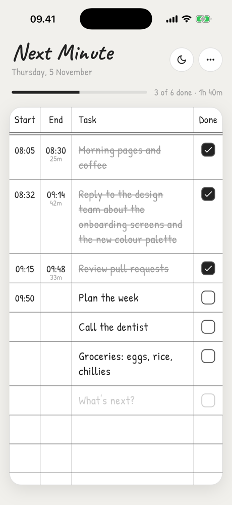
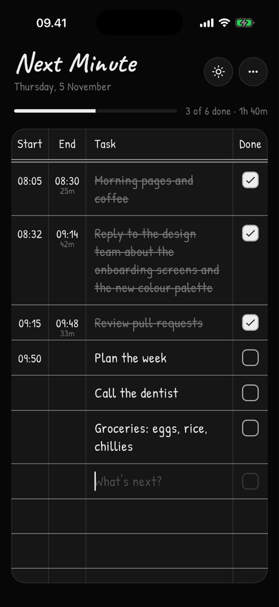
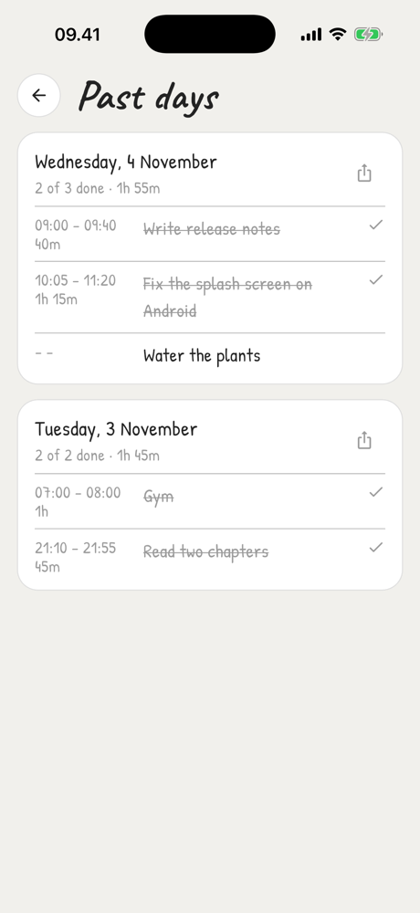

# Next Minute

A to-do list that looks like a page in a notebook. Each line has **Start**, **End**, **Task** and **Action** columns, so you see when you started something and how long it took.

<p align="center">
  
  &nbsp;
  
  &nbsp;
  
</p>

**[Download the Android APK](https://github.com/mraffiramdhani/next-minute/releases/latest)**

## Where the idea comes from

Next Minute is based on the method in [How I Stop Procrastinating with ADHD | The Next Minute Method](https://www.youtube.com/watch?v=MJ4q25LGyXQ) by [Novie by the Sea](https://www.youtube.com/@novie-bythesea). Watch the video for the method itself. This app is a notebook page for following it on your phone.

## Features

- Press **Enter** on a task to stamp its start time. Tick the checkbox to stamp the end time.
- Long tasks wrap onto as many lines as they need.
- Tap a time to edit it.
- Each task shows how long it took, and the top bar shows today's total.
- At the start of each day, yesterday's page moves to **Past days**.
- A "Still on it?" reminder fires when a task has run for 25 minutes. You can set it to off, 15, 25, 45 or 60 minutes.
- Share a day's page as plain text.
- Light and dark paper themes, set in handwriting fonts.
- A short tour runs on first launch.

## Build

```bash
flutter pub get
flutter run
```

### Android release

Release builds are signed with the key described in `android/key.properties`. That file and the keystore are not in this repository. To sign your own build, create them:

```properties
# android/key.properties
storePassword=...
keyPassword=...
keyAlias=upload
storeFile=your-upload-key.jks   # relative to android/
```

```bash
flutter build apk --release
flutter build appbundle --release
```

If `key.properties` is missing, release builds fall back to the debug key.

## Fonts

[Caveat](https://fonts.google.com/specimen/Caveat) and [Patrick Hand](https://fonts.google.com/specimen/Patrick+Hand) are used under the SIL Open Font License 1.1.
